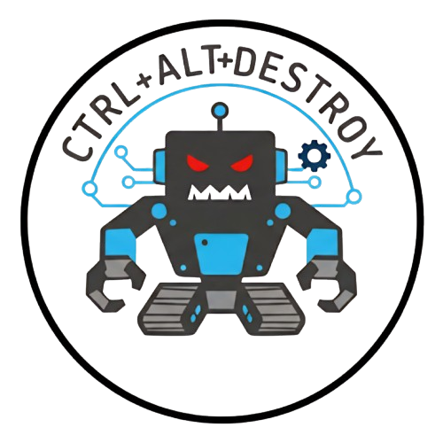

# Ctrl+Alt+Destroy

## Presentación del equipo

**Ctrl+Alt+Destroy** es un equipo dedicado al diseño y construcción de un robot BattleBot, combinando electrónica, modelado 3D, software y documentación técnica para desarrollar un robot funcional.

En la web del proyecto puedes consultar toda la información, documentación y avances del robot:

**Web del proyecto:**  
https://battlebots.robotica.gal/Ctrl-Alt-Destroy/

---

## Escudo del equipo

---

## Integrantes del equipo

### Carmen Sestelo Arias
GitHub: [@carmensesteloarias](https://github.com/carmensesteloarias)

**Rol:** Electrónica, diseño PCB y construcción del robot.

**Motivación:** Participar en el desarrollo electrónico del robot y aplicar conocimientos de integración de componentes y diseño de circuitos.

**Aportación al equipo:** Diseño de la PCB, integración de componentes electrónicos y construcción física del robot.

---

### Brais Maciñeiras Pena
GitHub: [@braisiiito](https://github.com/braisiiito)

**Rol:** Modelado e impresión 3D del chasis.

**Motivación:** Diseñar la estructura física del robot y trabajar en el desarrollo mecánico mediante modelado e impresión 3D.

**Aportación al equipo:** Diseño del chasis, modelado 3D y preparación de piezas para fabricación.

---

### Noelia Castro Rodríguez
GitHub: [@liln0e](https://github.com/liln0e)

**Rol:** Gestión del GitHub, web, documentación y apoyo en software.

**Motivación:** Organizar la documentación del proyecto y mantener la presentación visual y técnica del equipo.

**Aportación al equipo:** Gestión del repositorio, desarrollo de la web, documentación gráfica y técnica, así como apoyo en la generación de código del robot.

**Extra (muy importante):** Una vez terminado el robot, también me encargaré de decorarlo, pintarlo y añadir pegatinas para darle personalidad. No es estrictamente profesional ni especialmente relevante para la ingeniería, pero sí bastante gracioso y *silly*.

---

## Estructura del repositorio

Este repositorio está organizado para almacenar y documentar el desarrollo completo del proyecto.

- **README.md** → Información general del equipo y del proyecto.
- **web-proyecto/** → Código fuente de la página web y documentación visual del proyecto.
- **electronica/** → Diseño de circuitos, PCB y archivos de KiCad.
- **mecanica/** → Diseño del chasis, modelado e impresión 3D.
- **software/** → Código del robot y control del sistema.
- **.gitlab-ci.yml** → Configuración para la publicación automática de la web.

---

## Objetivo del repositorio

Este repositorio servirá para almacenar y documentar el desarrollo del proyecto, incluyendo avances relacionados con la electrónica, mecánica, software y documentación del robot.