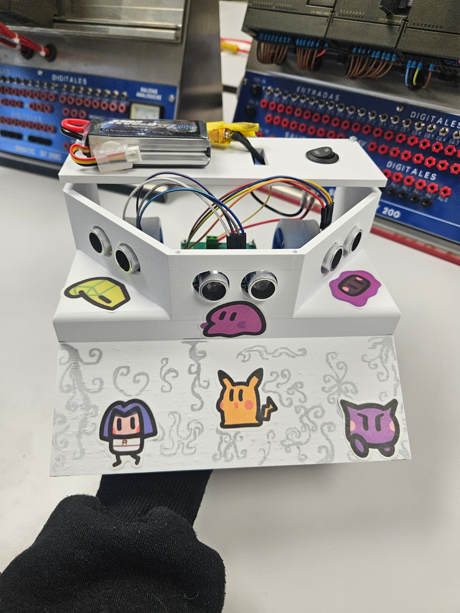

# Ctrl+Alt+Destroy

<p align="center">
  
</p>

<p align="center">
  <b>BattleBot de tipo sumo diseñado y construido por el equipo Ctrl+Alt+Destroy</b><br>
  Grado en Robótica · Escola Politécnica Superior de Enxeñaría (EPSE) · USC
</p>

<p align="center">
  <a href="https://www.youtube.com/live/FVRY-8WoZKk">▶ Ver la batalla</a> ·
  <a href="https://liln0e.github.io/Ctrl-Alt-Destroy/">Web del proyecto</a> ·
  <a href="https://battlebots.robotica.gal/Ctrl-Alt-Destroy/">Web oficial (battlebots.robotica.gal)</a>
</p>

---



## Descripción

**Ctrl+Alt+Destroy** es un robot BattleBot desarrollado como proyecto académico. Junta electrónica, modelado e impresión 3D, programación y documentación técnica en un robot funcional que compitió en el torneo de la asignatura.

- **Electrónica:** PCB propia diseñada en KiCad, con una ESP32 como controlador principal.
- **Mecánica:** chasis y tapa modelados e impresos en 3D.
- **Software:** código Arduino para el control de motores, la lectura de sensores y la lógica de combate.
- **Documentación:** web hecha con Jekyll, con documentación técnica, costes y fotos del proceso.

## Estructura del repositorio

```txt
Ctrl-Alt-Destroy/
├── README.md
├── LICENSE
├── electronica/   → Esquemático y PCB en KiCad
├── mecanica/      → Modelos 3D (.3mf) y G-code del chasis y la tapa
├── software/      → Código del robot (sumo_robot_final.ino)
└── web/           → Web de documentación (Jekyll)
```

Documentación detallada en la web:

- [Documentación técnica](web/documentacion.md)
- [Costes](web/costes.md)
- [Fotos del proceso](web/fotos.md)

## Equipo

| Integrante | Rol |
|---|---|
| **Carmen Sestelo Arias** · [@carmensesteloarias](https://github.com/carmensesteloarias) | Electrónica, diseño de la PCB, código y construcción del robot |
| **Brais Maciñeiras Pena** · [@braisiiito](https://github.com/braisiiito) | Modelado e impresión 3D del chasis, código y coordinación |
| **Noelia Castro Rodríguez** · [@liln0e](https://github.com/liln0e) | Repositorio, web, documentación y decoración del robot |

## Ver la web en local

```bash
bundle install
bundle exec jekyll serve --source web
```

## Licencia

Proyecto académico publicado bajo la [licencia MIT](./LICENSE).

## Sobre este repositorio

Esta es una copia del repositorio oficial del equipo, que está en GitLab (`epse-usc/Ctrl-Alt-Destroy`), con su historial completo. Aquí la web se publica en GitHub Pages con [`.github/workflows/pages.yml`](.github/workflows/pages.yml). El archivo `.gitlab-ci.yml` se mantiene porque es el que usa el repositorio oficial.
