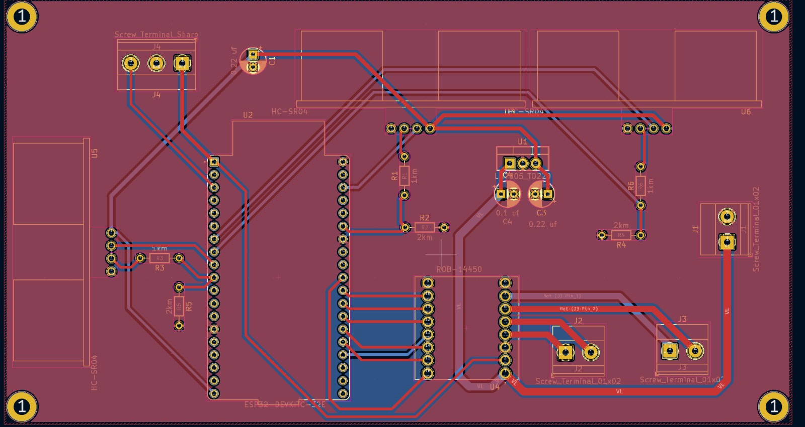
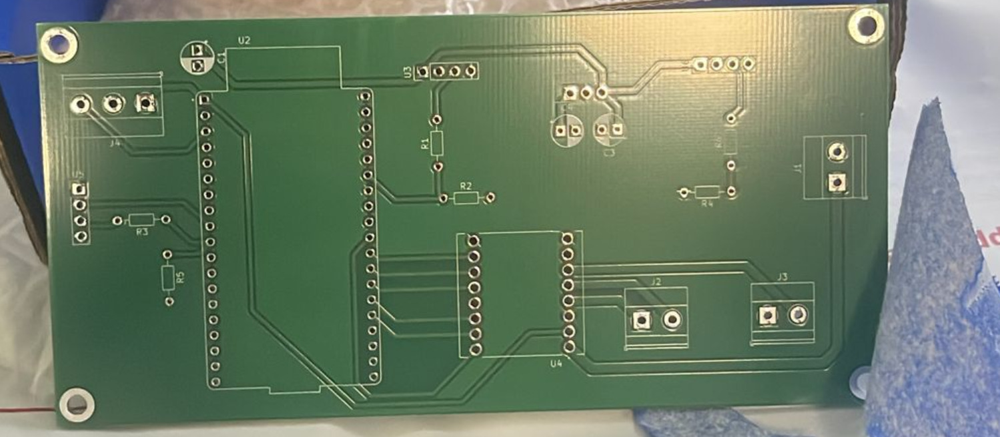

# Documentación del proyecto

En esta sección se recoge la información técnica relacionada con el diseño electrónico, mecánico y software del robot desarrollado por el equipo **Ctrl+Alt+Destroy**.

---

# Diseño mecánico

## Estructura general

El robot contará con un chasis diseñado mediante modelado e impresión 3D, pensado para integrar de forma compacta los elementos electrónicos y mecánicos necesarios para su funcionamiento.

La estructura incluirá:

- Chasis principal impreso en 3D.
- Soporte para PCB y componentes electrónicos.
- Sistema de tracción mediante motores.
- Espacio para batería y cableado.

## Objetivo del diseño

El objetivo del diseño mecánico es construir una estructura ligera, resistente y estable que permita alojar todos los componentes del robot y facilite el montaje.

**Responsable:** Brais Maciñeiras Pena.

---

# Diseño electrónico

## Objetivo

La parte electrónica del robot se centra en el diseño y fabricación de una PCB propia para integrar los componentes necesarios para el funcionamiento del robot.

La placa ha sido diseñada utilizando **KiCad**, permitiendo organizar conexiones eléctricas y facilitar el ensamblaje del sistema.

## Diseño de la PCB



Vista del diseño de la PCB realizado en KiCad, donde se pueden observar las conexiones, distribución de componentes y pistas eléctricas.

## PCB fabricada



PCB fabricada físicamente antes del ensamblaje de componentes.

## Archivos electrónicos del proyecto

Dentro del repositorio se incluyen los siguientes archivos:

- `sumo_robot.kicad_sch` → Esquemático electrónico del circuito.
- `sumo_robot.kicad_pcb` → Diseño de la PCB.
- `sumo_robot.kicad_pro` → Archivo del proyecto de KiCad.

**Responsable:** Carmen Sestelo Arias.

---

# Diseño de software

## Objetivo

El software del robot será el encargado de gestionar el comportamiento general del sistema, incluyendo el control de movimiento y la interacción entre componentes electrónicos.

## Funcionalidades previstas

- Control de movimiento del robot.
- Lectura de sensores.
- Gestión de motores y comportamiento del sistema.
- Ajustes y pruebas de funcionamiento.

El desarrollo del software se irá incorporando progresivamente al repositorio conforme avance el proyecto.

**Responsable:** Noelia Castro Rodríguez.

---

# Organización del repositorio

El proyecto está organizado en distintas carpetas para facilitar el trabajo colaborativo y la documentación:

```txt
electronica/
mecanica/
software/
web/
```

- **electronica/** → Diseño PCB y documentación electrónica.
- **mecanica/** → Modelado y diseño estructural del robot.
- **software/** → Código del robot.
- **web/** → Página web del proyecto.
