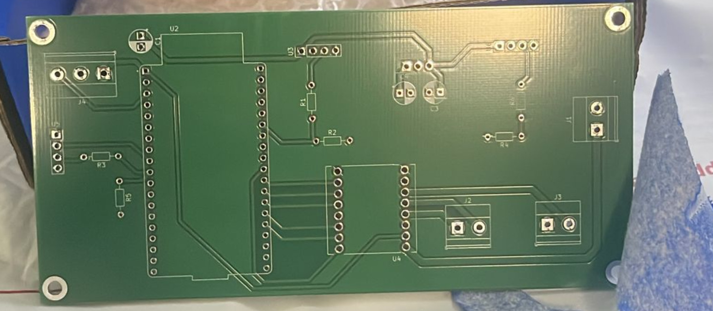

# Fotos del proyecto

En esta sección se muestran imágenes del proceso de diseño y construcción del robot del equipo **Ctrl+Alt+Destroy**.

## Diseño de la PCB

Diseño de la PCB realizado en **KiCad** para la integración de los componentes electrónicos del robot.

---

## PCB fabricada

PCB fabricada físicamente antes del ensamblaje de componentes y pruebas.

---

## Estado del proyecto

Actualmente el equipo se encuentra en fase de desarrollo, centrado en el diseño electrónico, planificación mecánica y preparación del sistema del robot. Se irán incorporando nuevas imágenes conforme avance el proyecto.