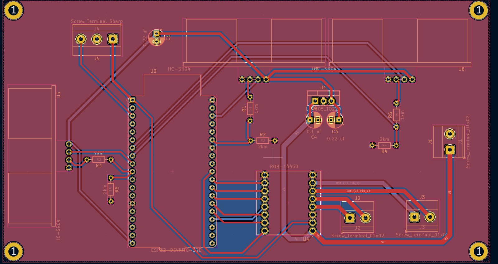

# Fotos del proyecto

En esta sección se muestran imágenes del proceso de diseño y construcción del robot del equipo **Ctrl+Alt+Destroy**.

  

    
    
Diseño de la PCB realizado en KiCad para la integración de los componentes electrónicos del robot.

  

  

    
    
PCB fabricada físicamente antes del ensamblaje de componentes y pruebas.

  

## Estado del proyecto

Actualmente el equipo se encuentra en fase de desarrollo, centrado en el diseño electrónico, planificación mecánica y preparación del sistema del robot. Se irán incorporando nuevas imágenes conforme avance el proyecto.

