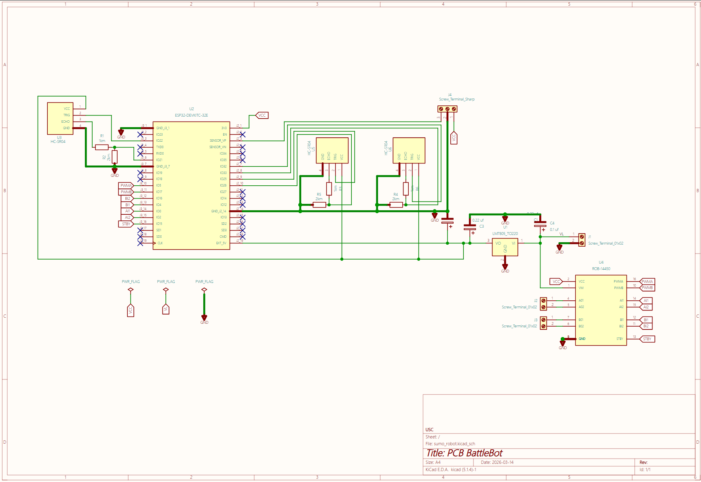
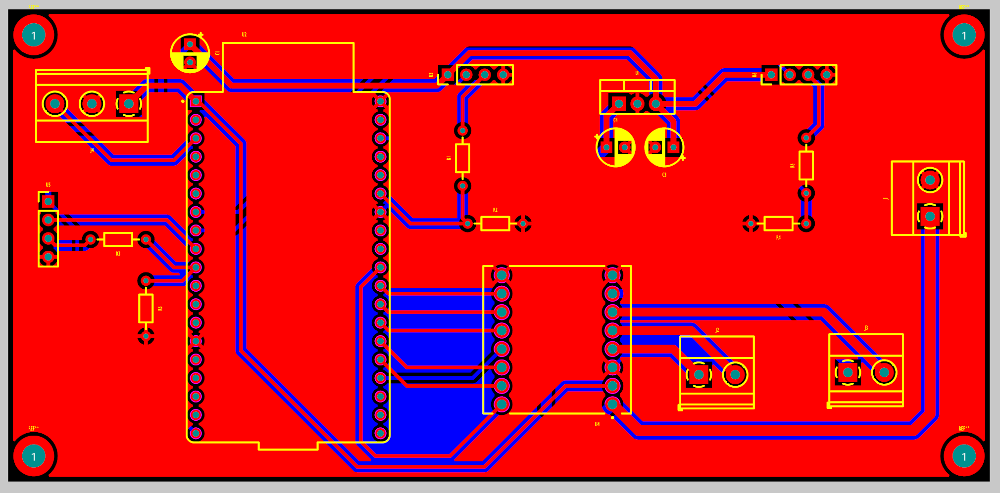
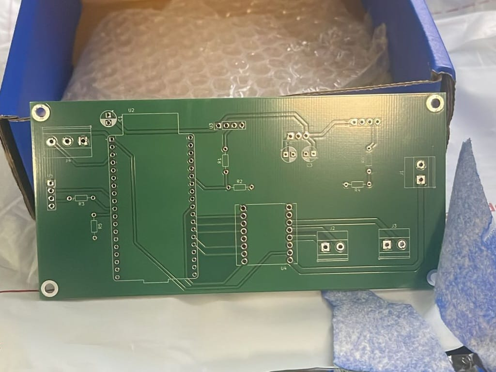
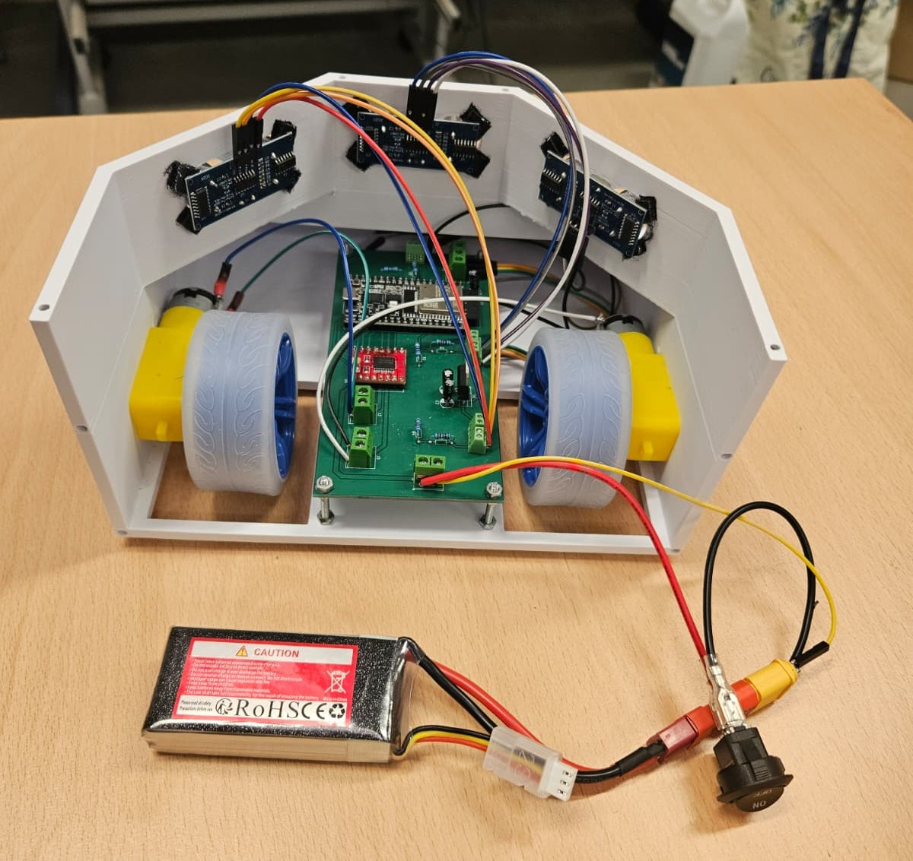
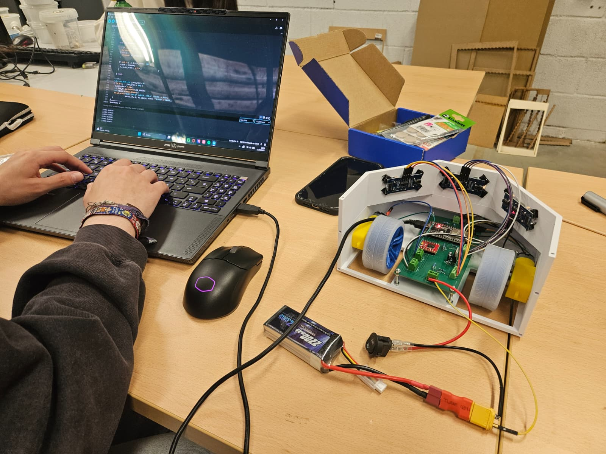
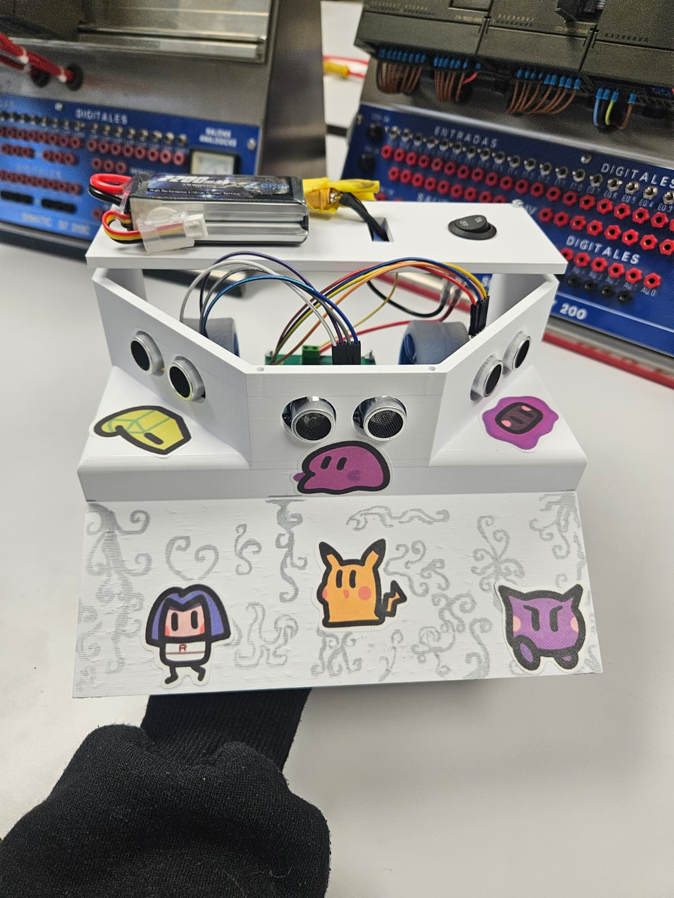

# Fotos del proyecto

En esta sección se muestran imágenes del proceso de diseño, construcción y pruebas del robot del equipo **Ctrl+Alt+Destroy**.

---

## Esquemático electrónico

Esquemático electrónico del robot realizado en **KiCad**, donde se representan las conexiones entre la **ESP32**, sensores, alimentación y controladores del sistema.

---

## Diseño de la PCB

Diseño actualizado de la PCB realizado en **KiCad**, incluyendo pistas, conexiones y distribución de componentes electrónicos.

---

## PCB fabricada

PCB fabricada físicamente antes del ensamblaje de componentes y realización de pruebas del sistema.

---

## Montaje del robot

Proceso de ensamblaje del robot con integración de motores, sensores, PCB personalizada y batería dentro del chasis impreso en 3D.

---

## Programación y pruebas

Pruebas de programación y ajuste del comportamiento del robot durante el desarrollo del proyecto.

---

## Robot final

Versión final del robot tras el montaje completo. Una vez terminado, también se decoró con pintura y pegatinas para darle personalidad propia. Aunque no sea especialmente profesional ni técnicamente relevante, hace que el robot sea mucho más gracioso, reconocible y bastante *silly*.

---

## Estado del proyecto

Actualmente el robot se encuentra ensamblado y funcional, integrando electrónica, estructura mecánica y programación desarrolladas por el equipo **Ctrl+Alt+Destroy**.