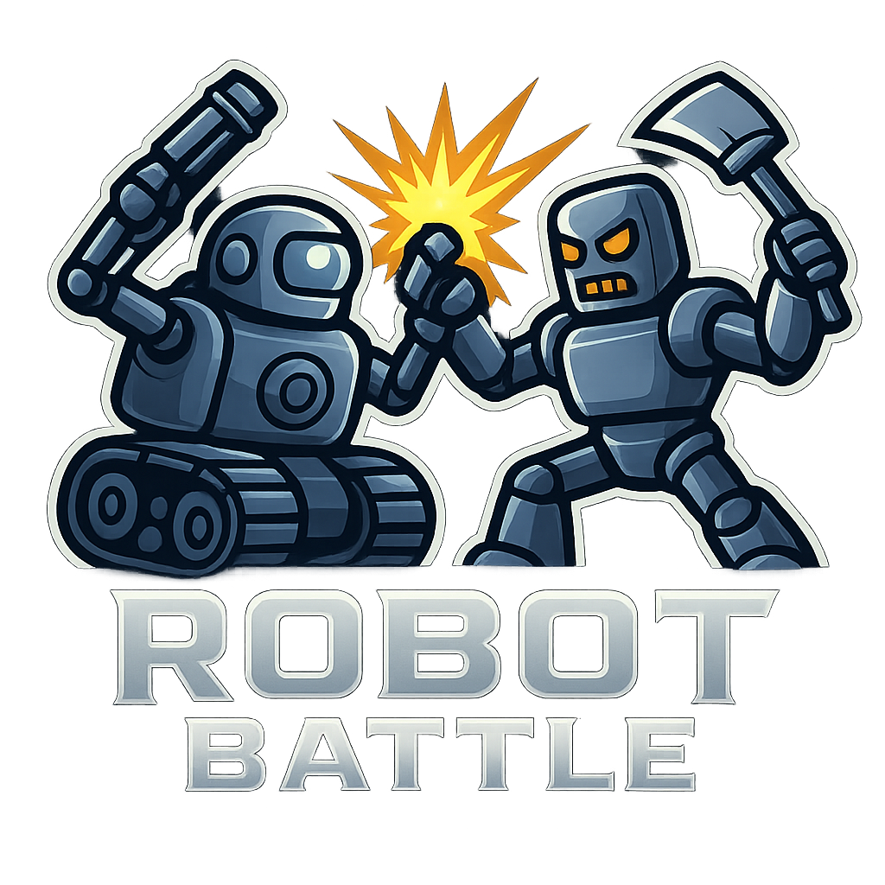

# Benvid@ a web do Equipo Modelo

En Equipo Modelo somos grupo de apaixonados pola enxeñaría e a robótica que se dedica á creación de **BattleBots de alto rendemento**. A nosa meta é combinar innovación, estratexia e tecnoloxía para competir ao máximo nivel en combates de robots. Apostamos por deseños robustos, solucións intelixentes e un forte espírito de equipo, buscando non só gañar batallas, senón tamén inspirar a novas xeracións no mundo da ciencia e da enxeñaría. Únete a nós nesta aventura onde a creatividade se transforma en metal e a paixón en movemento!

# O noso equipo 🤝

Aquí podes coñecer ás persoas que forman parte do proxecto:

  

    
    <h2>Enrique Comesaña Figueroa</h2>
    <h3><strong>Rol: </strong>Coordinador do equipo e responsable de deseño hardware e construcción</h3>
    
Como coordinador do equipo, encárgome de organizar o traballo e facilitar a comunicación entre todas as áreas do proxecto. Ademais, son responsable do deseño de hardware e da construción dos prototipos, asegurando que cada compoñente estea optimizado e cumpra cos requisitos técnicos. O meu obxectivo é combinar creatividade e precisión para transformar as ideas do equipo en solucións físicas robustas e funcionais.

  

  

  

    
    <h2>Daniel Nagy</h2>
    <h3><strong>Rol: </strong>Responsable de diseño e implentación de software</h3>
    
"Como responsable de deseño e implementación de software, dedícome a planificar a arquitectura das aplicacións e a desenvolver solucións eficientes que dean soporte ao funcionamento global do proxecto. O meu labor abrangue dende a definición da lóxica e a programación ata a integración co hardware, garantindo robustez, escalabilidade e un rendemento óptimo. O meu obxectivo é traducir as necesidades do equipo en ferramentas dixitais fiables e innovadoras.

  

  

  

    
    <h2>Marcos Fernández González</h2>
    <h3><strong>Rol: </strong>Responsable de comunicación (Web e documentación)</h3>
    
Como responsable de comunicación, son quen de dar visibilidade ao traballo do equipo a través da web e da elaboración de documentación clara e accesible. Encárgome de estruturar os contidos, manter actualizada a páxina oficial e asegurar que toda a información estea presentada de forma coherente e atractiva. O meu obxectivo é facilitar a comprensión do proxecto tanto dentro do equipo como cara ao público, reforzando a súa imaxe e impacto.

  

